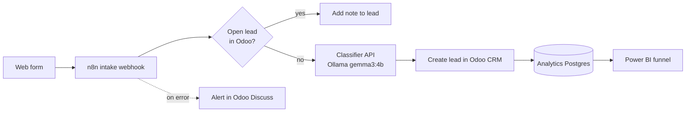
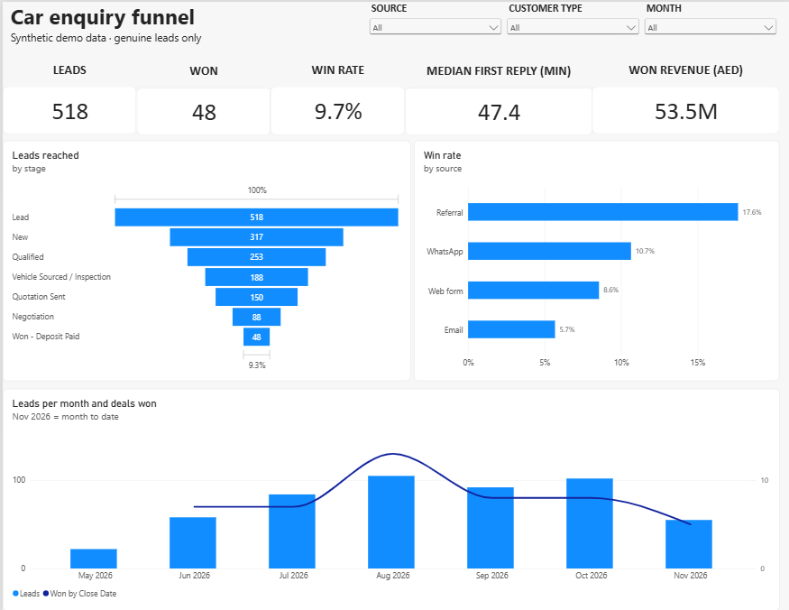
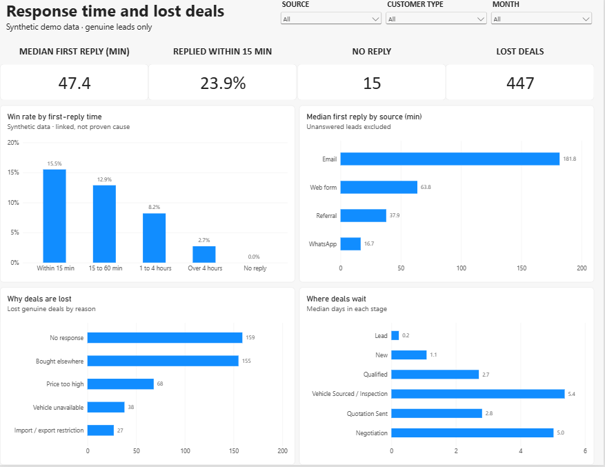

# Car enquiry lead pipeline

A working demo of how a car export/trading business can capture enquiries, sort them automatically and track them through a CRM pipeline.

**Web form → n8n → local LLM classifier → Odoo CRM → analytics database → Power BI**

> All data in this repo is synthetic. No real customer data is used.

## What it does

1. A customer submits an enquiry through a web form (name, phone, message).
2. **n8n** checks a shared secret, then looks for an open lead with the same phone number in Odoo.
   - If one exists, the new message is added as a note on that lead (no duplicates).
   - If not, the message goes to the classifier.
3. The **classifier** (a small FastAPI service calling a local model through Ollama) pulls out the facts: is it genuine, for resale or not, vehicle, quantity, budget, destination, urgency.
   Plain code, not the model, turns those facts into the customer type (Buyer, Distributor or Importer) and the total budget.
4. n8n creates the lead in **Odoo CRM** with tags, source and expected revenue. Spam is closed straight away as lost.
5. If any step fails, an error workflow posts an alert to an Odoo Discuss channel. Read-only steps retry automatically.
6. A separate **Postgres reporting database** holds lead history and stage changes for funnel reporting in **Power BI**.

## Status

| Part | Status |
|---|---|
| Odoo 19 CRM: stages, tags, sources, lost reasons | Done ([design](docs/crm-design.md)) |
| n8n intake, web form and error alert workflows | Done |
| Classifier API with local model | Done ([evaluation](docs/llm-evaluation.md)) |
| Analytics database with 6 months of synthetic history | Done |
| SQL views for funnel, conversion, response time and lost deals | Done ([views](sql/README.md)) |
| Power BI dashboard: funnel, response time and lost deals | Done ([measures](powerbi/README.md)) |
| Daily sync from Odoo to the analytics database | Planned |

## Dashboard

What the synthetic history shows (patterns built into the generator, not findings): leads answered within 15 minutes were won 15.5% of the time, against 2.7% for replies after 4 hours; "No response" and "Bought elsewhere" make up about 70% of lost deals; deals wait longest at Vehicle Sourced / Inspection (median 5.4 days).

## Classifier results

Tested on 20 written test cases and 10 hold-out cases it was never tuned on:

| Model | Test set | Hold-out |
|---|---|---|
| gemma3:4b (chosen) | 85% | 80% |
| llama3.2:3b | 65% | not run |

The sample is small, so these numbers show direction, not precision. Known failure cases and the planned fixes are in [docs/llm-evaluation.md](docs/llm-evaluation.md).

## Run it locally

Needs Docker Desktop (with WSL 2 on Windows) and about 8 GB of free RAM.

1. Copy `.env.example` to `.env` and fill in the passwords.
2. Start everything: `docker compose up -d`
3. Download the model: `docker compose exec ollama ollama pull gemma3:4b`
4. Open Odoo at http://localhost:8069, create the database, install CRM, and set up stages, tags and sources as in [docs/crm-design.md](docs/crm-design.md). Create an API key and add it to `.env`.
5. Run `python odoo/show_ids.py` and copy the IDs into `n8n/code/build_odoo_lead.js`.
6. Open n8n at http://localhost:5678, import the three workflows from `n8n/`, add a Header Auth credential, and publish them.
7. Load the synthetic history: `python analytics/generate_history.py`

All ports are bound to `127.0.0.1`, so nothing is exposed outside your machine.

## Repo layout

| Folder | Contents |
|---|---|
| `docs/` | CRM pipeline design and classifier evaluation |
| `odoo/` | Python scripts for the Odoo JSON-2 API |
| `n8n/` | Exported workflows and the Code node script |
| `llm/` | Classifier, API, Dockerfile and test cases |
| `analytics/` | Reporting database schema, read-only Power BI role, history generator |
| `sql/` | Reporting views, including the two shaped for Power BI |
| `powerbi/` | Measure definitions and dashboard notes (the `.pbix` itself is not committed) |

## Personal data

The demo stores names, phone numbers and messages. In a real deployment this is personal data under the UAE Personal Data Protection Law, so it would need a stated purpose and consent on the form, limited access, and a retention period.

## Licence

MIT
